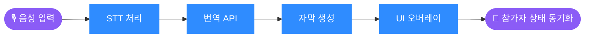
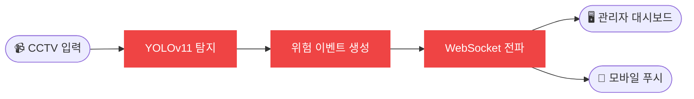
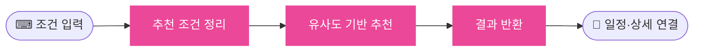
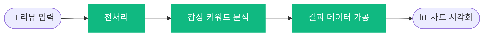

 

  

<table>
  <tr>
    <td align="center" width="170"><h1>8</h1><b>TEAM PROJECTS</b></td>
    <td align="center" width="170"><h1>5</h1><b>AWARDS</b></td>
    <td align="center" width="170"><h1>4</h1><b>BOOTCAMPS</b></td>
    <td align="center" width="170"><h1>70%</h1><b>MAIN PROJECT CONTRIBUTION</b></td>
  </tr>
</table>

<a href="#-about">ABOUT</a> &nbsp;·&nbsp;
<a href="#-skills">SKILLS</a> &nbsp;·&nbsp;
<a href="#-featured-project">FEATURED</a> &nbsp;·&nbsp;
<a href="#-projects">PROJECTS</a> &nbsp;·&nbsp;
<a href="#-awards">AWARDS</a> &nbsp;·&nbsp;
<a href="#-education">EDUCATION</a>

 

## 👋 About

전기공학을 전공한 뒤 개발자로 방향을 바꿨습니다. 빅데이터 · 언어지능 · 풀스택 · AI서비스개발 과정을 거치며 **React 화면부터 Spring Boot · Node.js REST API, FastAPI 기반 AI 연동**까지 직접 만들어 왔습니다.

> [!NOTE]
> **개발 가치관** — 작은 기능 하나에도 사용자 경험을 먼저 생각합니다. "일단 돌아가게"보다 "나중에 봐도 읽히는 코드"를, 빠른 임시 해결보다 **원인 추적과 재발 방지**를 선택합니다.

<table>
  <tr>
    <td width="33%" valign="top" align="center">
      <h3>🧩</h3>
      <b>서비스 구조 설계</b> 
      기능 간 연결 흐름과 상태 변화에 따른 UI 처리를 먼저 그린 뒤 구현합니다
    </td>
    <td width="33%" valign="top" align="center">
      <h3>🔌</h3>
      <b>API 설계 · 연동</b> 
      화면과 서버를 자연스럽게 잇는 REST API 구조를 설계합니다
    </td>
    <td width="33%" valign="top" align="center">
      <h3>🔍</h3>
      <b>문제 해결 · 디버깅</b> 
      로그와 데이터 흐름을 따라 원인을 추적하고 구조로 해결합니다
    </td>
  </tr>
</table>

 

## 🛠 Skills

| | |
| :-: | :-- |
| **Frontend** |  |
| **Backend** |  |
| **Database** |  |
| **Tools** |  |
| **Integration** | `LiveKit` · `WebSocket` · `OneSignal` · `Kakao Map` · `Chart.js` · `FullCalendar` |

 

## ⭐ Featured Project

### 🎥 Talaria
**두 세계를 잇는 실시간 AI 번역 화상회의 플랫폼**

<!-- 📸 스크린샷을 넣으려면 아래 주석을 풀고 docs/ 폴더에 이미지를 올리세요

  
  
  

-->

> 비즈니스 미팅과 K-컬처 라이브를 하나의 플랫폼에서. 실시간 번역에 **문화 맥락(밈·신조어·분위기)** 까지 전달하기 위해, 비즈니스 모드와 문화 모드를 분리한 **이중 경험 구조**로 설계했습니다.

| | |
| :-- | :-- |
| 🧰 **Frontend** | `React` `Vite` `Tailwind CSS` `LiveKit` `Axios` `Context API` `SweetAlert2` |
| 🧰 **Backend** | `Spring Boot` `MySQL` `FastAPI` (Papago STT) |

**담당 기능**

| 🖥 화상회의 | 🎨 문화·밈 UI | 📄 대시보드 · 문서 |
| :-- | :-- | :-- |
| 참가자 자동 배치 커스텀 그리드 실시간 STT 번역 자막 오버레이 매너 체크·문서·채팅 사이드바 | 테마별 배경 이펙트 신조어·밈 실시간 하이라이팅 이모지·임팩트 효과, 모바일 최적화 | FullCalendar 일정 관리 원문·번역본 대조 PDF 뷰어 Drag & Drop 업로드 |

**🧯 Troubleshooting — 참가자 간 상태 동기화**

> [!WARNING]
> **문제** &nbsp; 카메라 OFF 상태에서 설정한 배경이 다른 참가자 화면에 유지되지 않음 
> **원인** &nbsp; 로컬 상태만 갱신되고 다른 참가자에게 전파되는 메커니즘이 없었음

> [!TIP]
> **해결** &nbsp; LiveKit **DataChannel**로 설정값을 실시간 공유하고 참가자별 **State Map**을 구축 
> **결과** &nbsp; 모든 참가자 화면에서 배경 테마 일관성 확보, 구조 개선으로 재발 방지

 

## 📂 Projects

<b>🚨 Ask-Me</b> · YOLOv11 기반 실시간 흉기 소지자 알림 &nbsp;<code>2024.10 – 11 · 6인</code>

 

> CCTV 영상에서 흉기를 감지하고 관리자·경비원·일반 사용자에게 **위치 정보와 함께 즉시 알림**을 전달합니다.

| | |
| :-- | :-- |
| 🎯 **역할** | **웹·앱 프론트엔드, 백엔드, UI/UX** (기여도 70%, YOLOv11 모델은 팀원 담당) |
| 🧰 **Stack** | `React` `Flutter` `Bootstrap` · `Node.js` `WebSocket` `MySQL` `FastAPI` · `OneSignal` `Kakao Map` |

- 🛡 **시스템 관리자** — 통계 대시보드, 회원·커뮤니티 관리, 알림 내역
- 📹 **보안 관리자** — CCTV 감지 모니터링(알림창·트래킹 모드), 감지 이미지·녹화 영상 상세
- 🗺 **Kakao Map** — 반경 2km 흉기 경보, 인근 경찰서·병원 표시
- 📱 **Flutter 앱** — 위치 서비스, 알림 내역, 커뮤니티(좋아요·신고), WebSocket + OneSignal 푸시

> [!WARNING]
> **문제 · 원인** &nbsp; HTTP 환경에서 푸시 알림이 동작하지 않음 — OneSignal이 보안 정책상 **HTTPS를 요구**

> [!TIP]
> **해결 · 결과** &nbsp; OpenSSL로 HTTPS 인증서를 생성·적용해 웹–모바일 간 실시간 알림 연동 완성

🔗 [Web · Backend](https://github.com/Kim-Ji-Man/Ask-Me) · [Flutter App](https://github.com/Kim-Ji-Man/Ask-Me/tree/flutter_askme)

<b>💍 Wedding Plan</b> · 유사도 분석 기반 맞춤형 웨딩 플랜 추천 &nbsp;<code>2024.07 – 08 · 5인</code> 🏆 최우수상

 

> 광주 지역 결혼 예정자의 조건(지역·날짜·예산)으로 웨딩홀·스드메 조합을 추천합니다. 복잡한 준비 과정을 **단계형 입력 흐름**으로 단순화했습니다.

| | |
| :-- | :-- |
| 🎯 **역할** | **UI/UX, 프론트엔드, 백엔드 API 구조 설계, FastAPI 연동** (기여도 70%) |
| 🧰 **Stack** | `React` `Bootstrap` `Figma` · `Node.js` `MySQL` `FastAPI` · `Kakao Map` `OpenWeather` `FullCalendar` |

- Figma 설계 기반 반응형 웹 (메인·로그인·캘린더·웨딩플랜·상세·마이페이지)
- 단계별 조건 입력 UI, 유사도 기반 추천 결과 화면
- Kakao Map 위치 마커, 일정 캘린더 날씨 표시

> [!WARNING]
> **문제 · 원인** &nbsp; 단계 이동 시 이전 입력값이 사라져 추천 흐름이 끊김 — 단계별 로컬 상태 관리로 화면 전환 시 초기화

> [!TIP]
> **해결 · 결과** &nbsp; **React Context API** 전역 상태로 입력 데이터를 관리해 흐름 연속성 확보, 사용자 이탈 가능성 감소

🔗 [In_site](https://github.com/2024-AISCHOOL-APP/In_site)

<b>👟 ReadFit</b> · 신발 리뷰 분석 플랫폼 &nbsp;<code>2024.03 – 04 · 5인</code>

 

> 2030 남성 대상 신발 리뷰를 **키워드·감성 분석**해, 읽지 않고도 핵심을 파악하는 대시보드를 제공합니다.

| | |
| :-- | :-- |
| 🎯 **역할** | **프론트엔드, 백엔드, UI/UX** (기여도 70%) |
| 🧰 **Stack** | `React` `Chart.js` · `Spring Boot` `Flask` · `KcELECTRA` `KoELECTRA NER` · `Kakao Login` `Naver Clova` |

- 웰컴·메인·카테고리·상세·커뮤니티·로그인·챗봇·회원가입 전 페이지
- Chart.js 시각화 — 키워드 랭킹, 긍정·부정 분석, 리뷰 하이라이팅

> [!WARNING]
> **문제 · 원인** &nbsp; axios로 전달한 데이터가 시각화에 쓰이지 못함 — 요청/응답 구조 불일치, 시각화용 가공 미흡

> [!TIP]
> **해결 · 결과** &nbsp; **백엔드에서 데이터를 가공**해 전달하는 구조로 변경 → 전송 안정화, 프론트 부담 감소, 차트 정상 동작

🔗 [Frontend](https://github.com/illhanunjung/ReadFit-frontend) · [Backend](https://github.com/illhanunjung/ReadFit)

 

<table>
  <tr>
    <td width="50%" valign="top">
      <b>🗺 블로그 여행데이터 기반 AI 여행지 추천</b> 
      <code>2025.08</code> · 4인 · 프론트엔드  
      블로그 크롤링·임베딩(OpenAI)으로 여행 성향을 분석해 여행지·코스를 추천. 성향 분석 폼, 카드 결과 UI, KakaoMap 상세, Protected Routes 담당.  
      <a href="https://github.com/jingeunlee4559/miniproject2">Repository →</a>
    </td>
    <td width="50%" valign="top">
      <b>🧳 혼행족 여행 동행자 추천</b> 
      <code>2023.12 – 2024.01</code> · 4인 · 프론트엔드/백엔드  
      설문 데이터로 비슷한 동행자를 추천·매칭. 로그인, 메인 슬라이더, 지도(커스텀 오버레이), 리뷰 페이지 담당.  
      <a href="https://github.com/2023-SMHRD-IS-AI1/WithusRepo">Repository →</a>
    </td>
  </tr>
  <tr>
    <td width="50%" valign="top">
      <b>🚦 AI신호등 관리자 웹</b> 🏆 
      <code>2023.01 – 02</code> · 5인 · 프론트엔드 · 왕중왕전 대상 · 최우수상  
      도서벽지 지능형 교통제어 관리자 웹. 카카오맵 메인(AI 모드 ON/OFF), Chart.js 비교 차트, react-table 목록 담당.  
      <a href="https://github.com/2022-SMHRD-SW-BigData-1/SSG">Repository →</a>
    </td>
    <td width="50%" valign="top">
      <b>☕ 카페 좌석 예약 웹 (Camomile)</b> 🏆 
      <code>2022.10 – 11</code> · 4인 · 프론트엔드 · 우수상  
      동네 카페 좌석 예약·주문·지도 확인 서비스. 로그인, 카카오맵(마커 + 커스텀 오버레이) 담당.  
      <a href="https://github.com/2022-SMHRD-SW-BigData-1/Camomile">Repository →</a>
    </td>
  </tr>
  <tr>
    <td colspan="2" valign="top">
      <b>🌤 개인 포트폴리오 웹사이트</b> · 2025.06 – · 1인 개발  
      React · Vite · Tailwind, 라이트/다크 모드, 프로젝트 상세창(역할·문제 해결·기술 선택 이유·결과), Firebase Firestore 실시간 방명록, Vercel CI/CD, SEO 메타태그.  
      <a href="https://myportfolio-steel-delta.vercel.app/">Live Site →</a> &nbsp;·&nbsp; <a href="https://github.com/jingeunlee4559/myportfolio">Repository →</a>
    </td>
  </tr>
</table>

 

## 🏆 Awards

<table align="center">
  <tr>
    <td align="center" width="190"><h1>👑</h1><b>대상</b> 실전프로젝트 왕중왕전 <code>2022</code> · AI신호등</td>
    <td align="center" width="190"><h1>🥇</h1><b>최우수상</b> 핵심프로젝트 <code>2024</code> · 웨딩 플랜</td>
    <td align="center" width="190"><h1>🥇</h1><b>최우수상</b> 실전프로젝트 <code>2022</code> · AI신호등</td>
    <td align="center" width="190"><h1>🥈</h1><b>우수상</b> 실전프로젝트 <code>2025</code> · Talaria</td>
    <td align="center" width="190"><h1>🥈</h1><b>우수상</b> 핵심프로젝트 <code>2022</code> · Camomile</td>
  </tr>
</table>

 

## 🎓 Education

| 기간 | 과정 |
| :-: | :-- |
| `2025.06 – 12` | AI서비스개발자 과정 수료 |
| `2024.05 – 11` | 앱기반 인공지능(풀스택) 과정 수료 |
| `2023.09 – 2024.04` | 언어지능기반 분석 서비스모델 개발자 과정 · 스마트인재개발원 |
| `2022.08 – 2023.03` | 빅데이터 융합서비스 개발자 과정 · 스마트인재개발원 |
| `2018` | 조선대학교 전기공학과 졸업 |

 

**문제를 정의하고, 구조를 설계하며, 끝까지 완성도를 책임지는 개발자 이진근입니다.**

